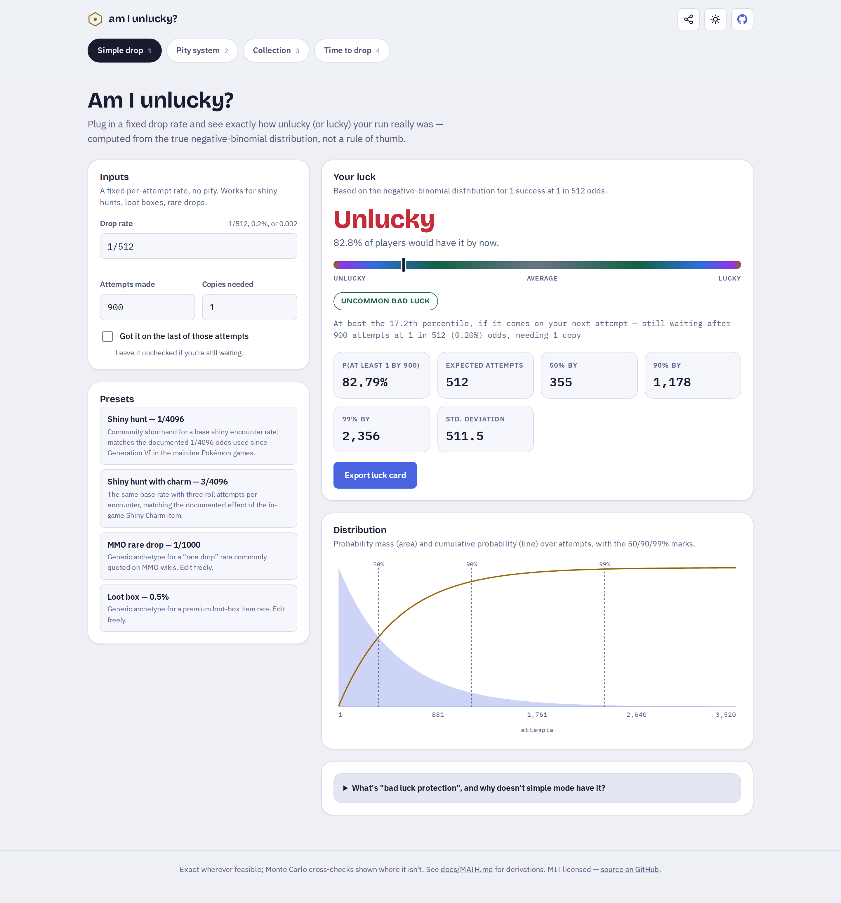
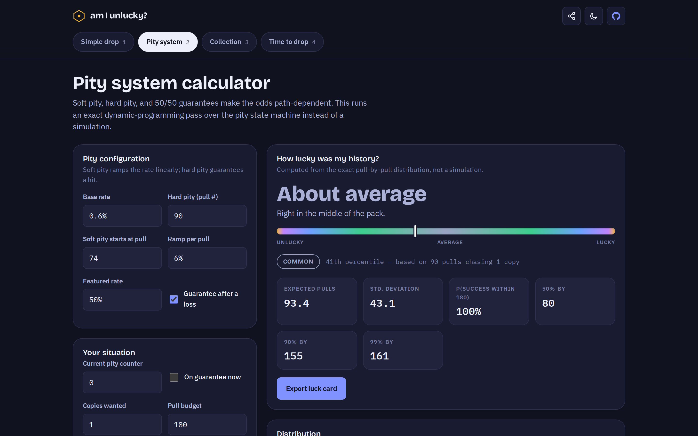
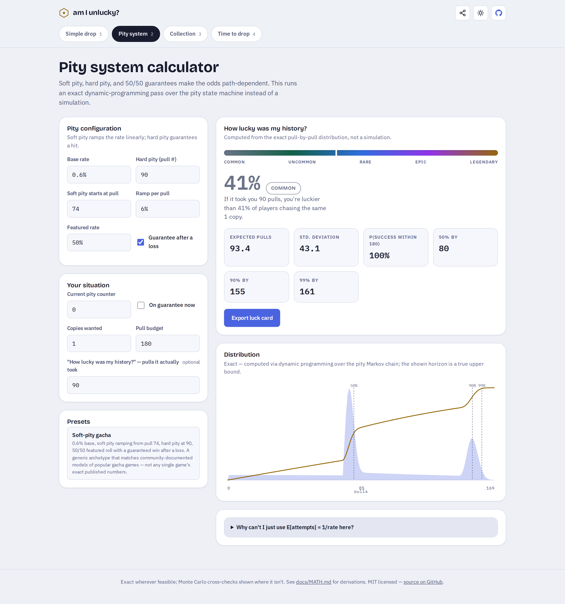
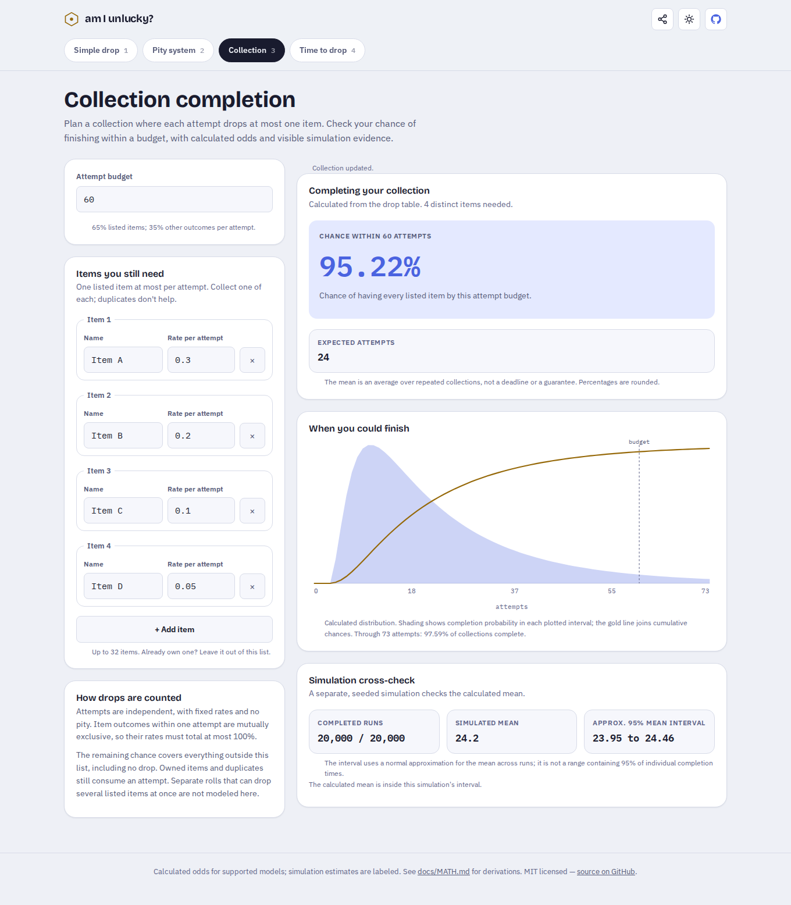
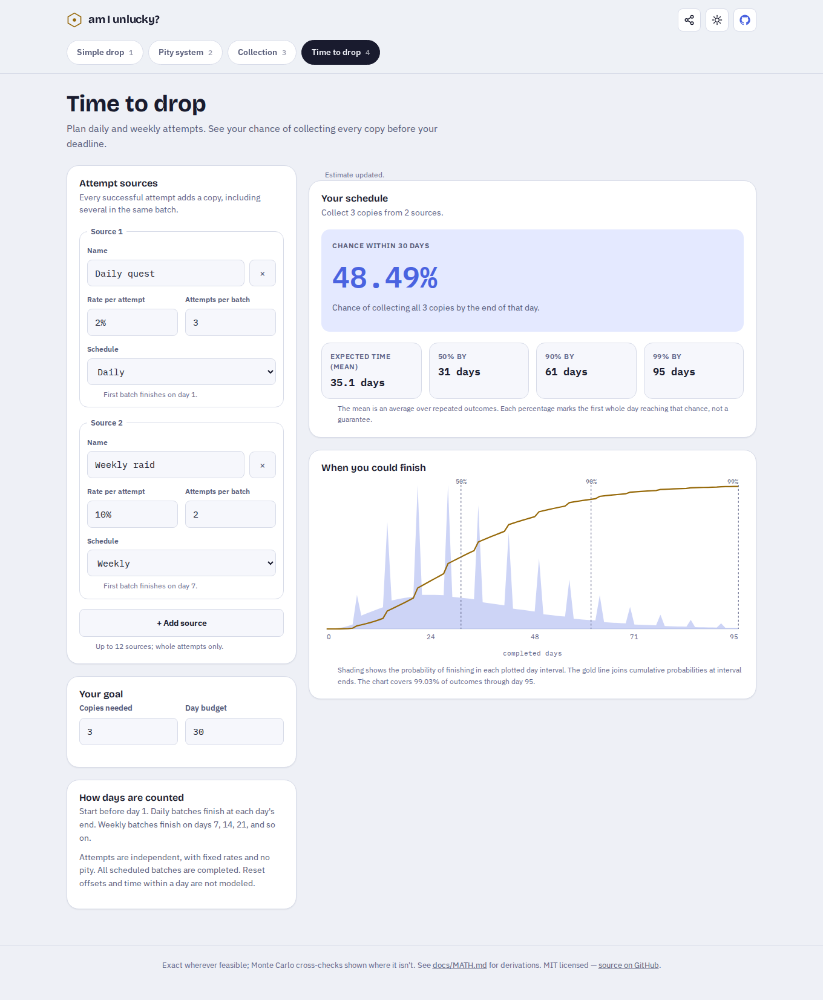
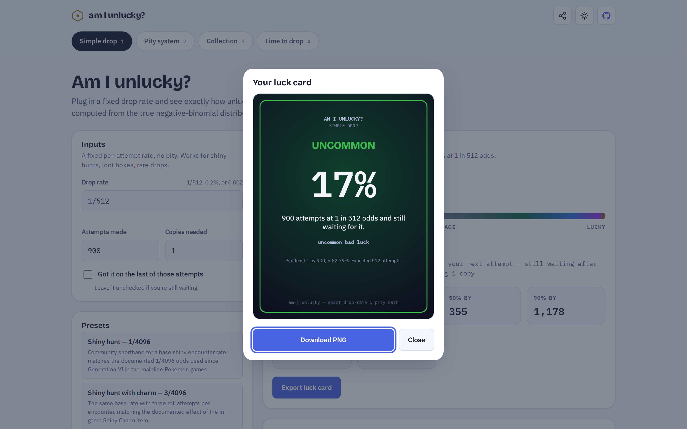
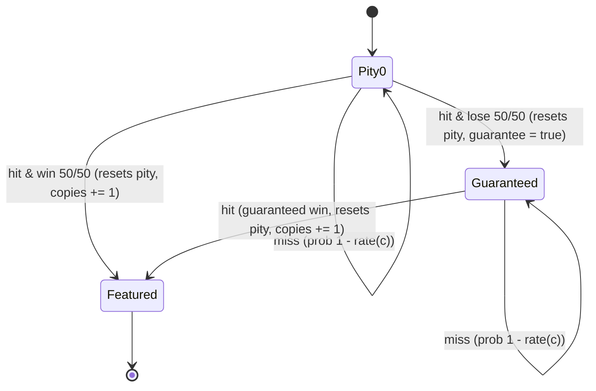

# am I unlucky?

**Exact drop-rate and pity math for gamers. Find out whether you're unlucky, or the system is.**

[](./LICENSE)
[](https://antonsoo.github.io/am-i-unlucky/)

Players constantly ask "is 900 runs for a 1/512 drop unlucky?" or "how many pulls do I need to be 90% sure?" Answering that correctly needs real probability, and it gets genuinely hard once a pity system is involved — soft pity, hard pity, and 50/50 guarantees make the odds change every pull, so the "expected attempts = 1 / rate" formula everyone reaches for is simply wrong. Most calculators floating around either hard-code one specific game or fall back to Monte Carlo simulation with no stated error bar. This one computes exact probabilities wherever that's mathematically feasible, and says so — with sample sizes and confidence intervals — everywhere it has to fall back to simulation instead.



## Plan from your next weekly batch

The source checkout lets each weekly source start on day 1–7, then repeat every
seven days. One 50% attempt starting on day 2 has a **9-day mean** and 50/90/99%
milestones on days **2 / 23 / 44**. Starting on day 7 retains the old **14-day
mean**. Separate sources can have different next batch days, and shared links
retain the choices. These are whole-day independent models, not game-history
measurements or calendar/time-zone forecasts.
[Exact rational reference, legacy controls and real browser workflows](studies/next-batch/README.md).
The live demo includes this capability; [clean-build and canonical-publication evidence](docs/verification-next-batch-2026-10-19.md) records the shipped result.

## Same-attempt finishes are ties

The source checkout and live demo fix a completed-history ranking error. First-try success
at a 90% rate used to say **Unlucky: 90% finished sooner**. Nobody could have
finished sooner. A two-roll 50/50 guarantee was labelled **Legendary bad luck**
although half the players finish on that same second roll.

| Completed model history            | Finished sooner | Same attempt | Took longer |
| ---------------------------------- | --------------: | -----------: | ----------: |
| First attempt, 90% drop rate       |              0% |          90% |         10% |
| Second roll, 50/50 then guaranteed |             50% |          50% |          0% |

Both now read **About average**. The page and exported PNG retain all three
shares. Rarity includes tied outcomes; unfinished runs report the fraction
still waiting, and impossible completed histories have no luck rating.
[Counterexamples, rational oracle and browser evidence](studies/tied-outcomes/README.md)
are retained. [Canonical hosted assets and actual offline downloads](studies/publication/tied-outcomes.md)
verify the live correction. No registry package was released.

## A small chance must not look like a short wait

Pity mode fixes a truncated-tail error. With a
1-in-10,000 featured chance and no guarantee, the previous calculator showed
**902.3 expected pulls** and put every milestone at 5,000. The full mean is
**10,000 pulls**. The mean and standard deviation now include the entire model;
uncalculated milestones, budget chances and history rankings remain explicit.
Large calculations run in cancellable workers.

[Before/after browser captures, independent rational oracle and limits](studies/pity-tails/README.md).
The live demo now includes this correction. [Served-file hashes and hosted
browser checks](studies/publication/README.md) verify the deployed behavior;
no registry package was published with that deployment.

## Checked against 27 million logged pulls

The bundled pity preset was an archetype nobody had checked. [`studies/paimon-pity`](./studies/paimon-pity/README.md) compares it with the five-star tallies that paimon.moe publishes for Genshin Impact's character banners (26.9 million five-stars, 98 banner phases, retrieved 2026-10-08). On pulls 74 to 83 the logged chance is within a point of the preset's ramp. The 50/50 was the part that mattered: the preset's 50% matches the logs before version 5.0, and the publisher's February 2025 post gives 55%, which the tool reads as the win rate on a roll with no guarantee; that takes "one copy within 90 pulls" from 59.4% to 63.5%. The logs read higher than 55% from version 5.5 and show no step at 5.0, for reasons not found. Above pull 84 the logged tail holds a few hundred more long streaks than the ramp allows and looks like miscounted records, so the new preset uses the ramp there. The source checkout and live demo include a preset built from the logs, labelled community data with its source, date and sample size, next to the old archetype. The answers are exact for the table; the table has sampling error and bias.

## Quickstart

```bash
git clone https://github.com/antonsoo/am-i-unlucky.git
cd am-i-unlucky && npm install
npm run dev
```

Open the printed `localhost` URL. That's the whole setup — no build step, no account, no server.

## Features

- **Simple drop** — a fixed rate `p`, attempts `n`, copies needed `k`, and whether you've got it yet. Compare earlier, same-attempt and later finishes, plus `P(at least k by n)`, expected attempts, and the attempts needed for 50/90/99% confidence, from the exact negative-binomial distribution. Still waiting, see the fraction of players who would also be waiting; no next-attempt completion is assumed.
- **Pity system** — base rate, soft-pity ramp, hard pity, and an optional 50/50-with-guarantee mechanic. Computed via an exact dynamic-programming pass over the pity Markov chain (not a simulation; exact for the rates given, which for a measured table carry sampling error): expected pulls, percentiles, `P(success within budget)`, and "how lucky was my history" for a pull count you actually used.
- **Collection** — complete a set where each attempt drops at most one listed item. Stable calculated means and completion odds for up to 16 items; labeled simulation estimates through 32. Censored runs and confidence intervals stay visible.
- **Time to drop** — choose the first day of each daily/weekly batch schedule, count every successful copy, and see the chance of finishing within a day budget, the expected time, and 50/90/99% milestones.
- **Presets with honest labels** — a generic soft-pity gacha archetype, a per-pull table measured from community-logged Genshin Impact pulls (source, date and sample size on its label), two shiny-hunt presets that cite Pokémon's actual documented encounter rates (1/4096, and 3/4096 with the Shiny Charm), and generic "MMO rare drop" / "loot box" archetypes. Every preset is fully editable; the UI says where each number comes from.
- **Shareable URLs** — the full input state lives in the query string, so a link reproduces exactly what you saw.
- **Luck card export** — a rarity-colored PNG ("common" through "legendary", using inclusive outcome tails, with ties kept visible) you can save and share.
- **Light + dark**, keyboard accessible, responsive to 320px, respects `prefers-reduced-motion`, zero tracking. Calculations run locally; calculation workers load from the same origin and need their asset cached or a working connection.



## Usage examples

**Simple drop** — 900 attempts at a 1/512 rate, needing 1 copy, still waiting:

| Metric               | Value                                          |
| -------------------- | ---------------------------------------------- |
| Verdict              | Unlucky: 82.8% of players would have it by now |
| P(at least 1 by 900) | 82.79%                                         |
| Still waiting too    | 17.21% of players                              |
| Expected attempts    | 512                                            |
| 50% / 90% / 99% by   | 355 / 1,178 / 2,356 attempts                   |

Had it dropped on attempt 900, 82.75% of players would have finished sooner,
0.03% on the same attempt, and 17.21% later (rounded). Still waiting after 100
attempts reads "not unlucky yet": 17.8% of players would have it by then.

**Pity system** — the bundled soft-pity gacha preset (0.6% base, soft pity from pull 74, hard pity 90, 50/50 with guarantee), asking for 1 copy from a fresh pity counter:

| Metric             | Value                |
| ------------------ | -------------------- |
| Expected pulls     | 93.4                 |
| Std. deviation     | 43.1                 |
| 50% / 90% / 99% by | 80 / 155 / 161 pulls |



**Collection** — 4 items at rates 0.3 / 0.2 / 0.1 / 0.05, at most one item per attempt. A positive subset recurrence gives the mean; a separate seeded simulation checks it:

| Metric            | Exact | Monte Carlo (n=20,000) |
| ----------------- | ----- | ---------------------- |
| Expected attempts | 24.00 | 24.20 ± 0.25 (95% CI)  |

Here the calculated mean lies inside the simulation interval. The UI also reports when it falls outside. The chance of completing this set within 60 attempts is **95.22%**. See [docs/MATH.md](./docs/MATH.md) for the derivation.



**Time to drop** — a 2%-per-run source at 1 run/day, needing 1 copy:

| Metric             | Value               |
| ------------------ | ------------------- |
| Expected time      | 50 days             |
| 50% / 90% / 99% by | 35 / 114 / 228 days |

For multiple copies, every successful attempt counts. With two attempts at
50% per batch and a goal of two copies:

| Schedule | Chance after 1 day | Chance after 7 days | Expected time |
| -------- | ------------------ | ------------------- | ------------- |
| Daily    | 25%                | 99.91%              | 2.22 days     |
| Weekly   | 0%                 | 25%                 | 15.56 days    |

Weekly batches default to days 7, 14, 21, and so on. Change **First batch (day)**
to start on another day of the first week; later batches stay seven days apart.
Daily and weekly sources
can be combined. Old integer daily-rate links still work; fractional daily
attempts now explain how to choose an explicit schedule instead.





## How it works

The full derivations live in [`docs/MATH.md`](./docs/MATH.md). Summary:

- **Binomial / negative-binomial tails** are summed term by term from an accurate binomial probability (Loader's saddle-point form, the algorithm behind R's `dbinom`), outward from the point asked about and away from the mean, where the terms only shrink. That keeps them exact from a handful of attempts to billions, and for $p$ as small as one in a trillion: 647 reference values from `scipy.stats.binom`, up to $n = 10^{15}$, are matched to nine significant digits — see `src/math/numeric.ts` and `docs/MATH.md`.
- **Pity systems** are modeled as a Markov chain with state `(pity counter, guarantee flag, copies obtained)` and solved by forward dynamic programming over pulls (`src/math/pity.ts`), which is exact — not simulated — whenever the guarantee mechanic bounds the DP horizon. Naive formulas fail here because the per-pull probability isn't constant (soft pity ramps it) and a lost 50/50 deterministically changes the next roll.
- **Collections** use a positive recurrence over missing-item subsets for the mean and stable inclusion-exclusion for the CDF (`src/math/collection.ts`). Event-based simulation jumps directly to each new item, so a rare drop does not require billions of loop iterations. Calculations run in cancellable workers.
- **Time to drop** convolves accumulated binomial copy counts from each scheduled source. Its mean uses a finite recurrence over the repeating daily/weekly cycle, without truncating time. Collapsing a day into a single success is valid only for the first copy; it gives incorrect multi-copy results.



## Accuracy and limitations

- Simple mode requires whole counts: attempts start at 0, copies at 1. Invalid
  counts stay visible for correction and cannot produce a result, card or share
  link; editing any input removes the previous card immediately. Valid settings
  remain immediately shareable. [Browser reproduction and before/after checks](studies/simple-inputs/README.md)
  cover the source correction; the hosted demo has not received this update.
- Simple-mode milestone and chart searches stop at 1,000,000,000,000,000 attempts.
  A result beyond that range shows a calculation-limit message; it does not mean
  the drop is impossible. Counts must be safe integers. This prevents very small
  rates in shared links from freezing the page. [Reproduction and independent
  checks](studies/simple-search/README.md).
- Binomial, negative-binomial, and geometric results are cross-checked in `tests/oracle.test.ts` against fixtures generated by SciPy (`scripts/oracle.py`, `scipy.stats.binom`/`nbinom`/`geom`), typically agreeing to 6-9 decimal digits.
- Scheduled-time results also have 32 independent 80-digit Decimal fixtures: an individual-attempt calculation with a proven bound below `1e-30` on its remaining expected time. Time mode supports 12 sources, 100 copies, and 1,000,000 attempts per batch. Budget and milestone searches stop at 1,000,000,000 days; later milestones are labeled beyond the limit, not impossible. The mean is not truncated at that horizon. Fixed rates, independent attempts, chosen whole-day first batches, and no pity or missed batches are assumed. Calendar dates, time zones and time within a day are outside this model.
- The pity distribution has a finite support when a lost roll guarantees the next hit, or the featured rate is 100%. Other positive featured rates need a truncated plot. In the source checkout, mean and standard deviation use the full model independently of that plot; unreached milestones and later budget/history probabilities stay uncalculated. A zero featured rate without a guarantee is impossible. These are model calculations, not proof of a game's actual rates.
- Collection mode models mutually exclusive item outcomes, with rates totaling at most 100%. Analytical results support 16 items; 17-32 items use simulation with approximate confidence intervals. Budgets, charts and simulated runs stop at one billion attempts; analytical means do not. If any simulation run is censored, its mean and mean interval are withheld. Tiny positive chances below numerical resolution are distinguished from impossible sets. Forty 120-digit Decimal fixtures independently verify the math; see [the derivation and limits](./docs/MATH.md#4-collection-mode).
- The "luck percentile" is defined as $100 \times (1 - P(T_k \le n))$ — the share of players who'd need more attempts than you did. That holds when the drop came on attempt `n`; for a player still waiting it is only an upper bound, so the verdict can be "Unlucky" or "Not unlucky yet" but not "Lucky" (see [docs/MATH.md](./docs/MATH.md)). At `n = 0` it is trivially 100%; the UI hides it until at least one attempt is entered.
- Presets are archetypes, not official data mining. Only the two shiny-hunt presets cite a specific published rate (Pokémon's documented 1/4096 base and 3/4096-with-Shiny-Charm encounter odds, in place since Generation VI); the pity preset and the MMO/loot-box presets are generic and explicitly labeled as such. Every number is editable.
- This is a client-side static site: no accounts, no analytics, nothing phones home (the page asks no other host for anything, and its Content-Security-Policy would not let it). Shared links embed your inputs in the URL query string in plain text.

## Development

```bash
npm test          # vitest
npm run lint       # eslint, strict + type-checked
npm run typecheck  # tsc --noEmit, strict mode
npm run build      # tsc --noEmit && vite build
npx playwright install chromium firefox
npm run test:browser # production build, Chromium + Firefox
```

Regenerating the SciPy oracle fixtures requires [`uv`](https://docs.astral.sh/uv/):

```bash
uv run --with scipy python3 scripts/oracle.py
python3 scripts/time-oracle.py # standard library only
python3 scripts/collection-oracle.py # standard library only
```

See [`CONTRIBUTING.md`](./CONTRIBUTING.md) for more.

## Contributing

Issues and PRs are welcome. Please keep `npm run lint`, `npm run typecheck`, and `npm test` green, and add oracle or property-based coverage for any new closed-form math.

## License

[MIT](./LICENSE) © 2026 Anton Soloviev

---

<sub>Part of [Officina](https://antonsoo.github.io/officina/), a set of small open-source tools by [Anton Soloviev](https://github.com/antonsoo).</sub>
