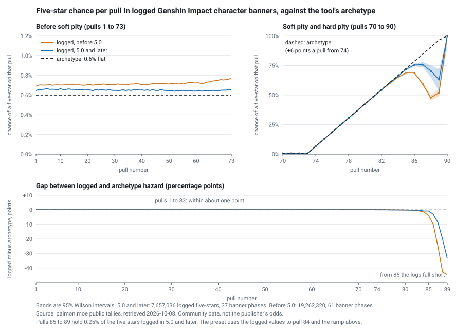
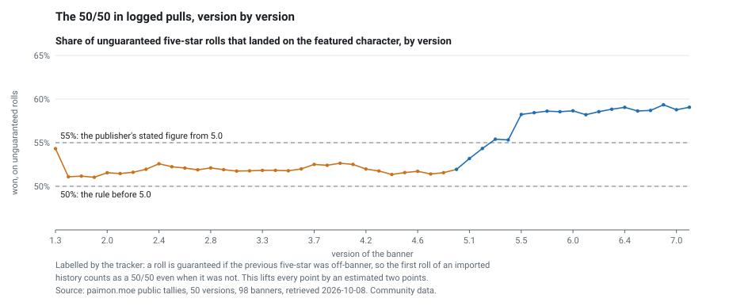

# The soft-pity preset against 27 million logged five-stars

The pity calculator is exact for whatever model it is given: a base rate, a soft-pity ramp, a hard pity, a 50/50 with a guarantee. Whether that model resembles any real game was never checked. The bundled preset ("0.6% base, soft pity from pull 74, hard pity 90, 50/50 with guarantee") is recognisably one game's limited-character banner, and the README admitted its curve was not from data. So a player asking "is 150 pulls for one copy unlucky?" got an exact answer to a question about an invented system.

paimon.moe, a community wish tracker, publishes per-banner tallies of the five-stars its users have logged, by pull number. This study reads them for Genshin Impact's character event banners and compares them with the preset, pull by pull and then in the numbers the tool reports.

**What came out**

- **The curve held.** Over 98 banners and 26,919,356 logged five-stars, the chance of a five-star on pulls 74 to 83 is within 0.25 points of the preset's 6-points-a-pull ramp in banners from version 5.0 on (7,657,036 five-stars) and within 0.74 points before 5.0. Before soft pity the logs read 0.65%, against the preset's 0.6%. Simulation shows that logged data of this kind overstates a flat 0.6% by about that much, and gives back the logged 60.3 pulls per five-star from an archetype whose true figure is 62.3 (below).
- **It fails at the top.** From pull 85 the logged chance falls below the ramp, by 3 points at 86, 9 at 87, 20 at 88 and 33 at 89 (5.0 and later). Those pulls hold 0.25% of five-stars, so the tool's answers barely move: for one copy, 50% / 90% / 99% by 80 / 155 / 161 pulls under the preset and 80 / 155 / 161 under the logged table (both with the 50/50 the preset has). The expected pulls change from 93.4 to 91.7.
- **The 50/50 is what the preset had wrong, and it matters.** The preset's 50% was the rule until version 4.8: the logs reproduce it (50.1% by one estimator, 50.0% by another, for the 61 banners before 5.0). The publisher says that from version 5.0 a five-star in the event wish has a "consolidated probability of 55.000%" of being the featured character. Moving the preset from 50% to 55% takes the chance of one featured copy within 90 pulls from 59.4% to 63.5%, and within 600 pulls for seven copies from 32.2% to 39.3%. That is a bigger change than anything in the hazard curve.
- **The logs read higher than the publisher's 55%.** For banners from version 5.5 on the featured share of five-stars is 71.2%, which implies a win rate on the 50/50 of 57 to 60% by the two estimators I could build, and the win rate climbs through 5.0 to 5.4 before it flattens. I do not know why. Opt-in submission is one candidate that I cannot test; a change to the mechanic is another, and I found no publisher statement of one.
- **The tracker's published denominators are not usable as they come.** The site publishes a count of pulls at each pity alongside the five-stars, but the server builds it only from users who got at least one five-star in that banner. Hazards computed from it are inflated by 5% at pull 1 and 32% at pull 30. The right denominator is reconstructed from the five-stars themselves, and I tested it on simulated pulls with a known hazard first.

**What changed in the tool (source checkout, unreleased).** A new pity preset, "Genshin Impact character banner, as logged (Oct 2026)", runs the same exact Markov chain on a per-pull table taken from the 5.0-and-later logs, with the publisher's 55%. Its label carries the source, retrieval date and sample size. The old preset stays, relabelled as an archetype with its 50/50 stated as the pre-5.0 rule. `PityConfig` gained an optional `rates` table; nothing is simulated.

## The data

**Source.** `https://api.paimon.moe/wish?banner=<id>`, the request the site's own "Global Wish Stats" page (`https://paimon.moe/wish/tally`) makes when you open a banner. One GET per banner, in order, 2.5 seconds apart, no login, no individual history, about 115 requests in all. Banner ids are the front end's own: 300001 to 300106 for character event banners (the list is in the MIT-licensed front end repository, pinned in `manifest.json`), and 200001 for the standard banner. The first eight (versions 1.0 to 1.2) answer "data is not available yet"; 98 return tallies, covering versions 1.3 to 7.1, banners started 2021-03-02 to 2026-09-23. Retrieved 2026-10-08; the site's own tally timestamps run from 2026-09-28 to 2026-10-08.

**Terms.** I found no terms of use and no `robots.txt` (that path returns the app shell). The privacy policy (`https://paimon.moe/privacy-policy`) says players who tick "Submit pity for global wish stats" have their pity counts and five-star records aggregated, and that these feed the stats page; it says the service never stores UIDs, passwords or names. The tallies are aggregates the site chose to publish. The raw tallies stay in a gitignored cache (`studies/paimon-pity/cache/`) and are not redistributed here; `results.json` holds only the pooled counts by pull number. No licence is stated for the tallies themselves.

**Size.** 26,919,356 logged five-stars across the 98 banners; 33,761,252 user-banner submissions; 1,677,260,131 tallied pulls of every rarity. For versions 5.0 to 7.1 (37 banners): 7,657,036 five-stars, 475,138,852 pulls. Pooling the tallies of different banners is done by summing the counts at each pull number.

**What the five-star counts are.** `pityCount.legendary[n]` is the number of five-stars logged on a banner at pull n of a streak (pull n since the previous five-star, wherever that was; the counter runs across banners). It sums to the banner's five-star total.

**The yardsticks.**

- The publisher's own post, "Capturing Radiance" Mechanic: You Ask, I Answer! (`https://genshin.hoyoverse.com/en/news/detail/125274`, published 2024-08-16, updated 2025-02-10). The page is client-rendered; the text was read from the JSON the page loads (URL and hash in `manifest.json`). It states a base chance of triggering the mechanic of 0.018%, a "consolidated probability of 55.000%" that a five-star in the event wish is the featured character, and a guarantee after the featured character was the second five-star on three occasions in a row. It says the mechanic arrives with the Version 5.0 update; paimon.moe's banner list puts the first banner of that version at 2024-08-28.
- The community wiki's Wish page (`https://genshin-impact.fandom.com/wiki/Wish`, CC BY-SA), read as wikitext: a 1.6% "consolidated rate, with guarantees" for the event character wish, "one 5-star character per 62.5 wishes", soft pity starting "at approximately the 74th wish", and the statement that the terms "pity", "banner" and "soft pity" are unofficial and that the existence and start of soft pity were "determined from player testing". This is a wiki, not the publisher. I could not retrieve the publisher's in-game rate page, so the base rate of 0.6% is not verified here against a publisher source; the preset's 0.6% is the tool's own number.

## The measure

For each pull n from 1 to 89, the hazard is `successes(n) / survivors(n)`, where `successes(n)` is the number of five-stars logged at pull n and `survivors(n)` is the number logged at pull n or later: the streaks that got as far as pull n and ended. At pull 90 the logged hazard is 1 by construction, because the server discards records with a pity above 90.

The estimator uses completed streaks only. Three things follow from that, and they are the reason I tested it on data with a known answer before using it.

1. **Left truncation.** A history starts at a pull the tracker can see; the streak it is inside at that moment has already been running for an unknown time. The tracker counts it from zero, so the first five-star of every history is logged at too low a pull number.
2. **Missing last streaks.** A history ends inside an unfinished streak, which never appears as a five-star and is therefore absent from `survivors`.
3. **The site's own denominators condition on success.** `countEachPity` is the sum, over user-banner records with at least one five-star, of the pulls made at each pity. A user who pulled 40 times on a banner and got nothing contributes nothing, although they were at risk at pulls 1 to 40.

`sim.py` draws segment lengths from the preset's own hazard, so the truth is known, and builds histories the way the logs are built: users with K completed streaks, a left-truncated first streak (a random moment lands in a streak with probability proportional to its length), a final streak cut off, pulls cut into banner windows. Then it applies each estimator.

| Scenario (truth: the archetype, 0.6% flat, ramp to 100% at 90)   | Result                                                                                                                                                         |
| ---------------------------------------------------------------- | -------------------------------------------------------------------------------------------------------------------------------------------------------------- |
| A. 3,000,000 independent complete streaks                        | survivor estimator within 0.0029 of the truth at every pull from 1 to 84                                                                                       |
| B. 12 completed streaks per user (first-streak share 8.3%)       | hazard at pull 1 is 0.68%, at pulls 10 to 60 0.66 to 0.69%, at 73 0.72%; mean 60.1 pulls per five-star against a true 62.3; ramp at 74 to 80 within 0.2 points |
| B. 4 and 40 completed streaks per user                           | base 0.84 to 1.1% with 25% first streaks; 0.61 to 0.65% with 2.5%                                                                                              |
| C. banner windows of 30 pulls on average, site-style denominator | hazard 0.71% at pull 1, 1.26% at pull 30 (truth 0.6%); the survivor estimator reads 0.71% and 0.71%                                                            |

Scenario B is the logged data's pattern. The logs show 0.64 to 0.77% before soft pity (0.65% pooled for 5.0 and later; before 5.0 a slow rise from 0.69% at pull 1 to 0.77% at 73), and 60.3 pulls per five-star pooled over all 98 banners (61.1 for 5.0 and later). That does not prove the real system is the archetype; it shows the preset plus these two biases is enough to produce the logs from pulls 1 to 83.

The sampling intervals in the figure are Wilson intervals that treat each five-star as independent. They are too narrow: the same player appears in many banners.

## Results



Hazard on pull n, pooled over character banners from version 5.0 to 7.1 (`results.json`, `pooled["5.0+"]`):

| Pull | Archetype | Logged, 5.0 and later (95% interval) | Streaks that reached it | Logged, before 5.0 |
| ---: | --------: | -----------------------------------: | ----------------------: | -----------------: |
|    1 |      0.6% |                 0.64% (0.64 to 0.65) |               7,657,036 |              0.69% |
|   30 |      0.6% |                 0.65% (0.64 to 0.65) |               6,327,372 |              0.71% |
|   73 |      0.6% |                 0.65% (0.65 to 0.66) |               4,785,013 |              0.77% |
|   74 |      6.6% |                 6.61% (6.59 to 6.64) |               4,753,701 |              6.76% |
|   76 |     18.6% |              18.60% (18.57 to 18.64) |               3,879,258 |             18.68% |
|   78 |     30.6% |              30.54% (30.48 to 30.59) |               2,383,657 |             30.59% |
|   80 |     42.6% |              42.53% (42.43 to 42.62) |               1,051,436 |             42.43% |
|   82 |     54.6% |              54.35% (54.18 to 54.53) |                 311,775 |             54.29% |
|   83 |     60.6% |              60.39% (60.13 to 60.64) |                 142,320 |             59.86% |
|   84 |     66.6% |              65.82% (65.42 to 66.21) |                  56,380 |             65.12% |
|   85 |     72.6% |              71.83% (71.19 to 72.46) |                  19,273 |             68.72% |
|   86 |     78.6% |              75.51% (74.34 to 76.63) |                   5,430 |             68.60% |
|   87 |     84.6% |              75.86% (73.49 to 78.09) |                   1,330 |             59.58% |
|   88 |     90.6% |              70.40% (65.19 to 75.13) |                     321 |             47.72% |
|   89 |     96.6% |              63.16% (53.12 to 72.17) |                      95 |             52.08% |

Two odd-numbered halves of the 5.0-and-later banners (4,822,881 and 2,834,155 five-stars) differ by at most 0.54 points at any pull from 1 to 84, so the table is not one banner's accident.

Consolidated rate, from the mean pulls per five-star: archetype 62.3 pulls (1.605%); logged 5.0 and later 61.1 (1.636%); logged before 5.0 60.0 (1.668%); the wiki's 1.6% is 62.5. The logs are 2 to 4% short of the wiki, which is the direction and rough size the two biases produce (scenario B: 60.1 against 62.3).

The tail is the open question. The simulation does not reproduce a shortfall of the size the logs show at pulls 87 to 89 (true hazards 84.6 to 96.6%; logged 75.9 to 63.2% for 5.0 and later), and the two eras disagree with each other there (at 88: 70.4% and 47.7%). I did not find the cause. It could be real (the ramp may not run straight to 100%), or an artefact of how records with impossible pity are discarded, or of how the tracker handles gaps in a history. Whatever it is, those pulls are 0.25% of five-stars.

### What the tool answers

The same exact chain, four settings (`answers.mjs`, `answers.json`). Fresh pity counter, 50/50 pending, one copy:

|                                                                              | Archetype, 50/50 (released 0.4.0 preset) | Archetype hazard, 55% | Logged hazard, 50/50 | Logged hazard, 55% (new preset) |
| ---------------------------------------------------------------------------- | ---------------------------------------: | --------------------: | -------------------: | ------------------------------: |
| Mean pulls                                                                   |                                     93.4 |                  90.3 |                 91.7 |                            88.7 |
| Std. dev.                                                                    |                                     43.1 |                  42.6 |                 43.2 |                            42.7 |
| 50% / 90% / 99% by                                                           |                           80 / 155 / 161 |        79 / 155 / 161 |       80 / 155 / 161 |                  79 / 155 / 161 |
| P(within 90 pulls)                                                           |                                    59.4% |                 63.5% |                60.3% |                           64.3% |
| P(within 120 pulls)                                                          |                                    70.5% |                 73.4% |                71.9% |                           74.7% |
| Share of players who would need at least as many pulls as a 150-pull history |                                    20.9% |                 18.8% |                19.4% |                           17.5% |

Two copies, 50/50 pending:

|                     | Archetype, 50/50 | Archetype hazard, 55% | Logged hazard, 50/50 | Logged hazard, 55% |
| ------------------- | ---------------: | --------------------: | -------------------: | -----------------: |
| Mean pulls          |            186.9 |                 180.7 |                183.4 |              177.3 |
| 50% / 90% / 99% by  |  183 / 265 / 314 |       174 / 253 / 313 |      179 / 260 / 314 |    170 / 249 / 313 |
| P(within 180 pulls) |            48.7% |                 53.2% |                50.7% |              55.2% |
| P(within 270 pulls) |            90.9% |                 92.6% |                91.8% |              93.3% |

Seven copies: mean 654.1, 632.3, 642.0, 620.6 pulls; P(within 600) 32.2%, 39.3%, 36.1%, 43.3%; P(within 800) 89.9%, 93.1%, 91.6%, 94.3%. On a guarantee, one copy: mean 62.3 and 61.1 (archetype and logged), 50% / 90% / 99% by 76 / 80 / 83 in all four.

Reading across: the hazard curve moves the answers by about 2% (total variation distance between the one-copy distributions, archetype against logged hazard with the same 50/50: 0.025). The 50/50 moves them by about 3 to 4% in the mean and 4 to 7 points in budget probabilities. Both together: 5%, and up to 11 points for seven copies. The "released" column is the 0.4.0 preset with the code of 0.4.0; the three others need this checkout.

### The 50/50



`list[].guaranteed` counts copies the tracker's client flagged as guaranteed (the previous five-star on the banner track was not featured). Featured, flagged and non-featured five-star counts per banner give two readings.

- **Labelled win rate**, `(featured - flagged) / (featured - flagged + non-featured)`: 51.9% for the 61 banners before 5.0 (95% interval 51.88 to 51.93), 57.1% for the 37 from 5.0.
- **Featured share** of all five-stars: 66.7% before 5.0, 70.3% from 5.0. If every roll is won with probability w when not guaranteed and a loss guarantees the next, the share is 1/(2 - w): 66.7% for w = 0.5 and 69.0% for w = 0.55.

Both readings carry a bias. The tracker cannot know the guarantee state of the first five-star in a history, so it labels it "50/50"; about a third of those were guaranteed and won, which counts as 50/50 wins. With 8% of rolls first rolls, that lifts a true 50% to 51.9% (4%: 51.0%) and a true 55% to 56.6% (4%: 55.8%). The pre-5.0 numbers give the check: the labelled rate 51.9% corrects to 50.0% at 8% first rolls, and the featured share 66.7% implies 50.1%. The rule was 50% with a guarantee, and both readings recover it.

Applying the same two corrections by version gives:

| Banners            | Labelled win rate | Featured share | w from share | w from labelled (4% / 8% first rolls) |
| ------------------ | ----------------: | -------------: | -----------: | ------------------------------------: |
| before 5.0 (61)    |             51.9% |          66.7% |        50.1% |                         51.0% / 50.0% |
| 5.0 to 5.4 (10)    |             54.0% |          68.5% |        54.0% |                         53.1% / 52.2% |
| 5.5 and later (27) |             58.7% |          71.2% |        59.5% |                         58.0% / 57.3% |

So the rule did change in the logs at version 5.0, as the publisher says, and the size of the change from 5.5 on is 7 to 9 points, not the 5 the publisher states. Between 5.0 and 5.5 the win rate rises version by version (figure). I do not explain that. The preset uses the publisher's 55.000%, because the logs are opt-in, the first-roll correction is mine, and a gap of 2 to 4 points could be a selection effect as easily as the game. The field is editable.

## What was wrong and what changed

- The preset's 50% described the game it resembles up to version 4.8. For a player on a current banner it understated the chance of the featured character by 5 points per roll. The archetype keeps the 50%, and its description now says that.
- The hazard curve was right to within a point up to pull 83 and optimistic about pulls 85 and up. Nothing in the tool depended on those pulls, but the tool could only say "exact for this model"; it can now say "exact for this table, and the table comes from this".
- `PityConfig.rates?` takes a per-pull table in place of the base rate and ramp (hard pity and the guarantee are unchanged). The new preset carries one, generated from `results.json` by `make_table.py` into `src/logged-rates.ts`. The pity panel says when a table is in use, drops it as soon as the base rate, soft pity, ramp or hard pity is edited, and keeps it in share links as `table=<preset id>` (only ids the build ships are honoured).
- Tests: the table reproduces the parametric chain exactly when it is the parametric curve; the one-copy distribution under the new preset equals an independent renewal calculation (one streak, then a second guaranteed one with probability 1 - w) to 12 digits; share links keep and sanitise the table id.

## What is left

- The tail above pull 85, and the rise in the 50/50 win rate between 5.0 and 5.5, are unexplained.
- Weapon banners and the standard banner are not used. The standard banner pools 6,647,742 five-stars but reads a base of 1.3% and 49.5 pulls per five-star, which is what scenario B gives when most histories contain few streaks; I did not build a preset from it. Weapon banners have a different pity (80) and a different featured rule.
- No second game. The brief asked for others by the same publisher if their aggregates are public; I did not look beyond Genshin Impact.
- The 50/50 correction for first rolls needs the share of first rolls; I bracketed it at 4 to 8% from the simulation and the early hazard, not from the tallies.

## What this does not show

- That the logs are the game. They are what opt-in tracker users submitted. The self-selected are not the average player, and a tracker user who got a bad run may be less (or more) likely to submit. The tally cannot tell.
- That the real hazard is the logged one. The logs are shorter than the wiki's figure by 2 to 4%, and I showed one mechanism (truncation and cut-off streaks) that does that; I did not correct the table for it, so the new preset is the logs as they are, a little short in the bulk.
- Anything about the publisher's real odds. The publisher's figures here are the Q&A post's 0.018%, 55.000% and the three-in-a-row guarantee. The 0.6% base and the 6-points-a-pull ramp are community numbers; the logs agree with them, which is not a publisher confirmation.
- That the logged win rate of 57 to 60% is a change in the game. It may be one; it may be selection.
- Independence. Intervals treat five-stars as independent draws; they are not, since one player contributes many.
- Anything after 2026-10-08. The current banner (version 7.1) was still accumulating; the tallies carry time stamps from 2026-09-28 on.

## Reproduce

```bash
cd studies/paimon-pity
python3 -I fetch.py cache                      # about 4.5 minutes; 107 GETs, 2.5 s apart; ~1.3 MB
python3 -I fetch_refs.py .                     # the official post, the wiki page, pinned commits -> manifest.json
git clone https://github.com/MadeBaruna/paimon-moe <dir> && git -C <dir> checkout 0a88d5391005a4331a1413966528dd1762ce2614
python3 -I meta.py <dir> banners.json          # banner list and five-star characters (read as text, never run)
python3 -I sim.py <tmp>/sim.json               # about 80 s
python3 -I analyze.py . <tmp>/sim.json         # -> results.json
python3 -I figure.py .                         # -> hazard.svg, fifty.svg
python3 -I make_table.py results.json ../../src/logged-rates.ts
# the tool's answers, from this checkout's own math
cd ../.. && npx tsc src/presets.ts --outDir <tmp>/js --module nodenext --moduleResolution nodenext --target es2022 --strict --skipLibCheck
echo '{"type":"module"}' > <tmp>/js/package.json
node studies/paimon-pity/answers.mjs <tmp>/js studies/paimon-pity/answers.json
```

The tallies change as users submit, so a re-run gives larger counts and slightly different numbers; the pinned hashes are in `manifest.json`.

## References and licences

- paimon.moe tallies: `https://api.paimon.moe/wish?banner=<id>`; stats page `https://paimon.moe/wish/tally`; privacy policy `https://paimon.moe/privacy-policy`. No licence stated for the data; not redistributed here.
- paimon.moe front end, MIT: `https://github.com/MadeBaruna/paimon-moe` (commit 0a88d53). Server, read to learn how the tallies are built: `https://github.com/MadeBaruna/paimon-moe-api` (commit 7080596); no licence file was found at its root.
- HoYoverse, "Capturing Radiance" Mechanic: You Ask, I Answer!, `https://genshin.hoyoverse.com/en/news/detail/125274`. Quoted briefly.
- Genshin Impact Wiki, Wish, `https://genshin-impact.fandom.com/wiki/Wish`, CC BY-SA. Quoted briefly.
- Everything else (scripts, `results.json`, `answers.json`, figures) is this repository's, MIT.
