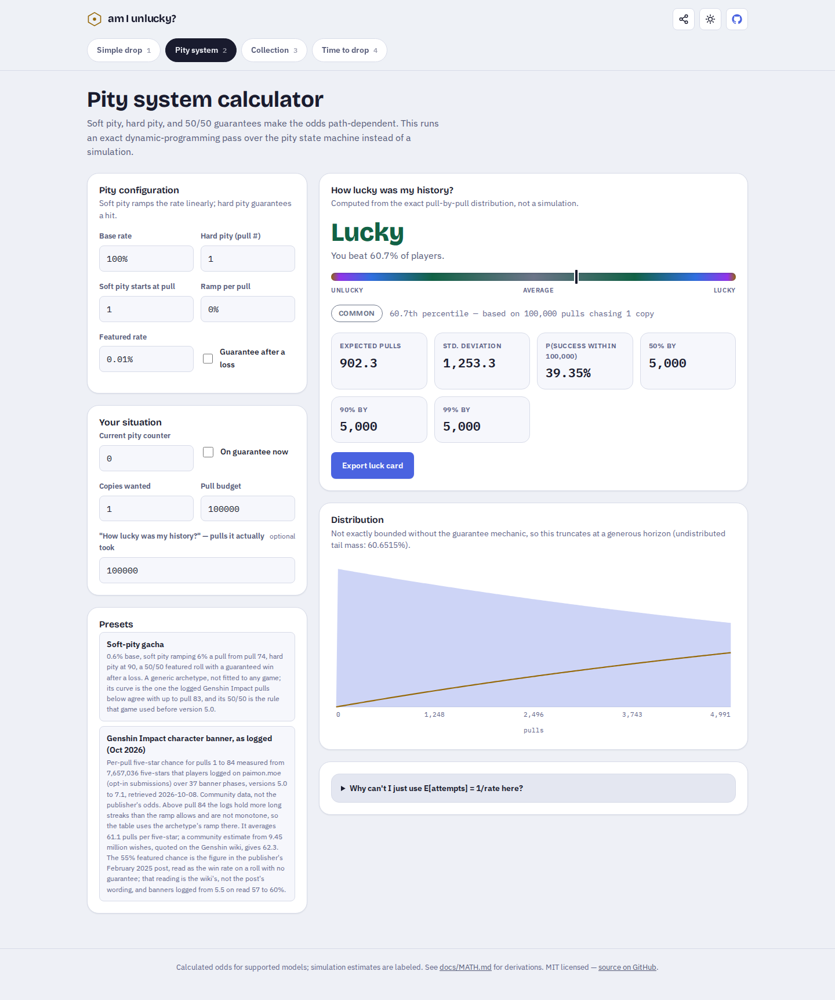

# A truncated probability plot cannot supply the full mean

The previous source (`9f505f7`) dropped a pity distribution's uncomputed tail
from its mean and variance, substituted the calculation horizon for unreached
milestones, and reused the final computed probability for any larger budget
or history. The page disclosed a tail below the chart, but its main answers
and downloaded luck card still treated those incomplete calculations as answers.

This correction is in the source checkout. It does not establish which version
is served by the hosted demo or claim that a game's rates follow this model.

## A closed-form counterexample

Set hard pity to 1, the featured rate to 0.01%, and turn off the guarantee.
Every pull reaches the item tier, then independently has a 1-in-10,000 chance
of being featured. This is exactly a geometric distribution; no game data,
simulation, or fitted estimate is needed to check it.

| Quantity | Previous output | Corrected source | Independent full answer |
| --- | --- | --- | --- |
| Expected additional pulls | 902.3 | 10,000 | 1/p = 10,000 |
| Standard deviation | 1,253.3 | 9,999.5 | sqrt(1-p)/p |
| 50% milestone | 5,000 | >5,000; not yet calculated | 6,932 |
| 90% milestone | 5,000 | >5,000; not yet calculated | 23,025 |
| 99% milestone | 5,000 | >5,000; not yet calculated | 46,050 |
| Success within 100,000 | 39.35% | Not calculated | 99.9954623% |
| History at 100,000 | "Lucky", 60.7th percentile | Not calculated; no luck-card export | Strictly-more percentile 0.0045377 |
| Success within 5,000 | 39.35% | 39.35% | 1 - (1-p)^5000 |

The positive tail after 5,000 is **60.65154956%**. The corrected calculator
reports what its finite DP actually established. It does not extrapolate later
quantiles or probabilities from a smaller budget. The full mean and standard
deviation now come from a separate renewal calculation and remain available.
The geometric formulas above are independent references for this controlled
configuration; they are not implemented as an extra special-case shortcut.

[Actual before](results/browser-before.json) and
[actual after](results/browser-after.json) retain the production page's text,
tiles, export state and the text drawn into its real downloaded PNG. The images
below are browser screenshots, not mockups.




The observed page has no horizontal overflow at 375 or 1440 pixels. Phone
captures are [before](../../docs/assets/pity-tails/before-375.png) and
[after](../../docs/assets/pity-tails/after-375.png). Both widths were visually
checked. All captured pages produced zero page errors.

For a **calculated** history of 100 pulls and a budget of 5,000, export remains
available. The [old card](../../docs/assets/pity-tails/before-card.png) says an
expected 902 pulls; the [new card](../../docs/assets/pity-tails/after-card.png)
says 10,000. Both were downloaded from the actual application.

## Independent mathematics

[`scripts/pity-oracle.py`](../../scripts/pity-oracle.py) constructs 84 small
absorbing Markov chains. It uses exact rational Gaussian elimination to solve
`(I-Q) mean = 1` and `(I-Q) second_moment = 1 + 2 Q mean`. This accounts for
arbitrarily many repeated visits without cutting the distribution off. It
also advances the chain for 32 pulls and retains those cumulative probabilities.

The oracle varies the hard pity, number of copies, featured chance, starting
counter and initial guarantee. Its supplied tier-rate tables include nonmonotone
rates and zero rates. The production implementation instead calculates the
moments of one tier cycle backwards, then combines the independent reset
cycles. The two implementations do not share a recurrence or source code.
See the [derivation](../../docs/MATH.md#3-the-pity-markov-chain).

The [math replay](replay.mjs) transpiles and runs the actual selected checkout.
Its [baseline](results/before.json) and [corrected results](results/after.json)
retain inputs, expected values, observed values, timings and source hashes.
Nine scenarios include one unchanged bounded-distribution control; eight
expose earlier behavior. Non-finite values are written explicitly as strings
so an impossible mean is not confused with an uncalculated `null`.

## Reproduce

From the repository root:

```sh
npm ci
npm run build
node studies/pity-tails/replay.mjs --out /tmp/pity-after.json
```

Run `python3 scripts/pity-oracle.py` to regenerate the exact rational fixtures,
`npm test` to check the calculations, and `npm run test:browser` to exercise
the production site in Chromium and Firefox. The browser checks include actual
PNG downloads, invalid-input correction, worker startup failures and retries,
stale replies, and cancellation of a large real calculation by changing tabs.

To replay the baseline, export `git archive 9f505f7` into a separate directory
and pass its `src/` using `--src /path/to/before/src --observe-only`. It needs
no dependencies of its own for this math replay. To inspect either production
UI, build that checkout with `npm ci && npm run build`, start `npm run preview`,
and use the URL it prints:

```sh
node studies/pity-tails/observe-browser.mjs \
  --base http://localhost:4173/am-i-unlucky/ \
  --out /tmp/pity-browser.json --prefix /tmp/pity-browser
```

## Boundaries and compatibility

- The mean and standard deviation describe the supplied mathematical model,
  with independent featured rolls and repeated identical reset cycles. They
  do not validate community rate tables or a game's implementation.
- The plot remains limited to a finite DP horizon. Unbounded calculations can
  stop once surviving mass is below `1e-15`; the positive mass is retained.
  Later probabilities remain uncalculated even if that tail is very small.
- The source API now returns `null` for uncalculated milestones and probabilities;
  impossible milestones are `Infinity`. An impossible completion has infinite
  mean and undefined standard deviation (`NaN`). Valid input still uses ordinary
  double-precision arithmetic, not arbitrary precision.
- History percentiles now consistently mean the share taking **strictly more**
  pulls, excluding ties. This changes earlier pity percentiles by the probability
  of tying. The app suppresses luck verdicts and cards for deterministic outcomes,
  unsupported history times and uncalculated histories.
- The product of copies and hard pity is limited to 4,000. A browser worker is
  terminated after 15 seconds; edits or navigation cancel it earlier. The direct
  synchronous library API has no wall-clock deadline. Input validation happens
  before allocation, and valid edited inputs can still be shared immediately.
- This study is a set of controlled counterexamples and independent numerical
  checks. It is not an empirical measurement of game outcomes or user behavior.

## Clean-checkout verification

Code commit `1d3b045` passed a fresh `git archive` checkout with `npm ci`,
ESLint, TypeScript, **402 numerical/unit checks**, the Vite production build,
and **120 browser checks in Chromium and Firefox**. Pity accessibility checks
covered light and dark modes at 375 and 1440 pixels. The [clean replay](results/clean.json)
agrees in all nine scenarios. The exact-rational fixtures contain 84 complete
moment solutions and 2,688 independent cumulative-probability values.

The static application builds with `npm run build` into `dist/`. No package
version was incremented and no registry package was published. Source pushes
and the version running at the public Pages URL are separate states.
