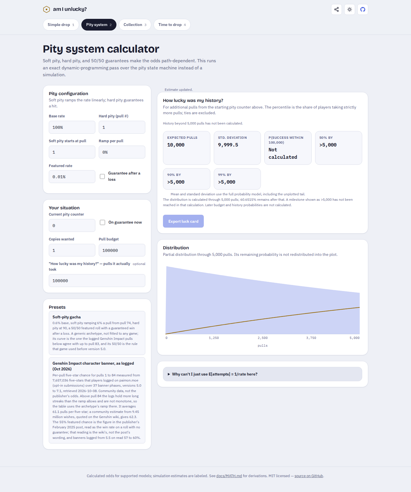

# Publish the correction people can actually use

On 2026-10-11 UTC, the public demo still served the earlier pity-tail error even
though `main` contained its repair. A fresh Chromium visit with a 1-in-10,000
featured chance and no guarantee showed **902.3 expected pulls**, all milestones
at 5,000, and a **Lucky** verdict for 100,000 pulls. The
[hosted before capture](results/hosted-before.json) records its URL, loaded bundle
and exact displayed results.

Source revision `97455f9` was rebuilt in a fresh archive. Lint, TypeScript, 402
numerical checks, all nine [counterexample replays](results/clean-replay.json),
and 120 production browser workflows passed. The existing source repair was
then published through the existing `gh-pages` branch in `fd36656`; this work
does not claim new authorship of that math correction.

| Same hosted input      | Before  | After                                         |
| ---------------------- | ------- | --------------------------------------------- |
| Expected pulls         | 902.3   | 10,000                                        |
| Standard deviation     | 1,253.3 | 9,999.5                                       |
| 50/90/99% milestones   | 5,000   | Beyond calculated 5,000-pull horizon          |
| Success within 100,000 | 39.35%  | Not calculated                                |
| 100,000-pull history   | Lucky   | Beyond calculated horizon; no verdict or card |

The finite plot still leaves 60.6515% beyond its horizon. That mass is explicit
and does not shorten the full-model mean. This verifies the supplied mathematical
model, not the rules or outcomes of a game.

All **35 served files** matched the clean build byte for byte. The
[file receipt](results/served-bytes.json) includes expected and served SHA-256
values. The [after capture](results/hosted-after.json) records the displayed
correction and new bundle. Twenty further workflows ran against the actual
hosted site in Chromium and Firefox: PNG download, invalid-input correction,
worker errors/retries, stale replies, cancellation of a real large calculation,
and accessibility in light/dark at 375 and 1440 pixels. No unexpected external
requests, page errors or CSP violations were observed.

The build command is `npm run build`, output `dist/`. The source revision and
Pages revision are separate, recorded in [verification.json](results/verification.json).
This is a static-site deployment. No registry package or tag was published,
and local checks are not a claim about remote CI. Receipts are snapshots at
their recorded check times.
